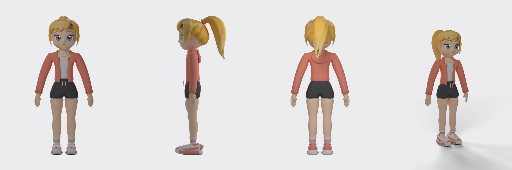
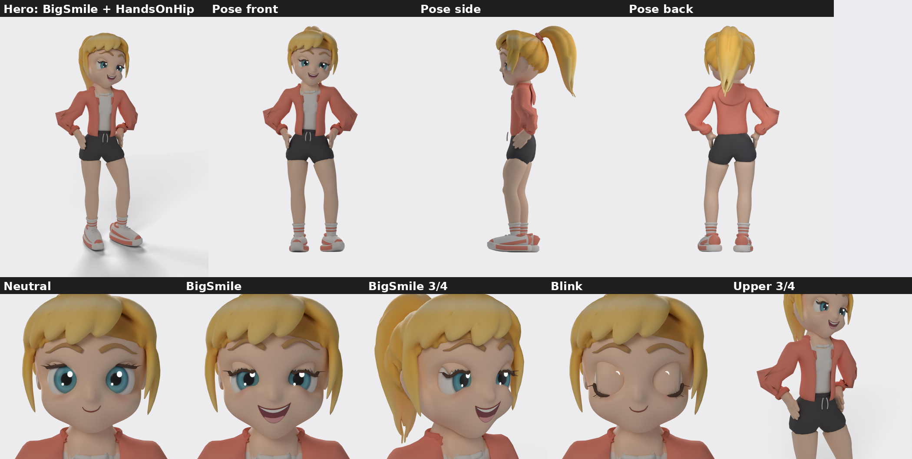
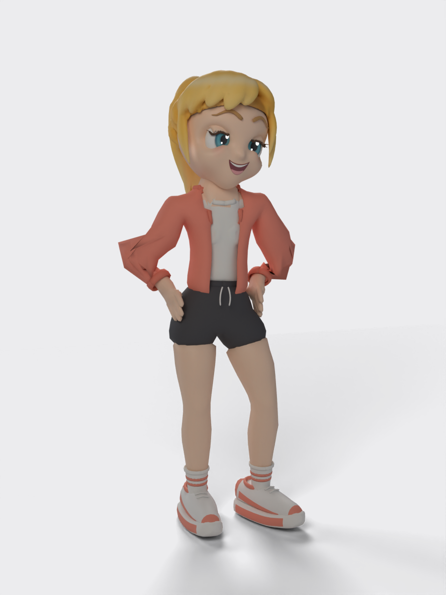
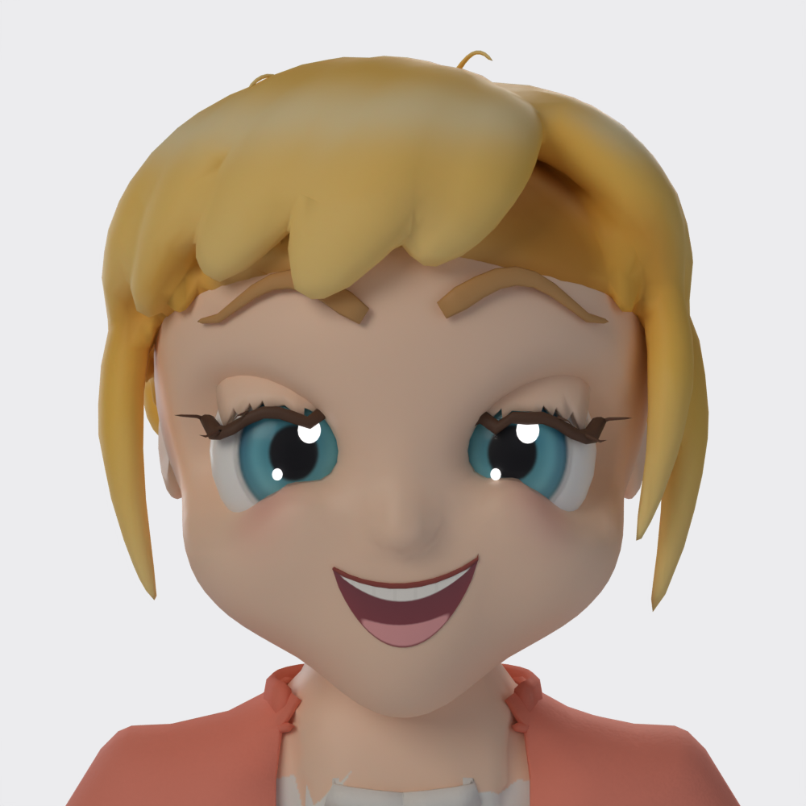
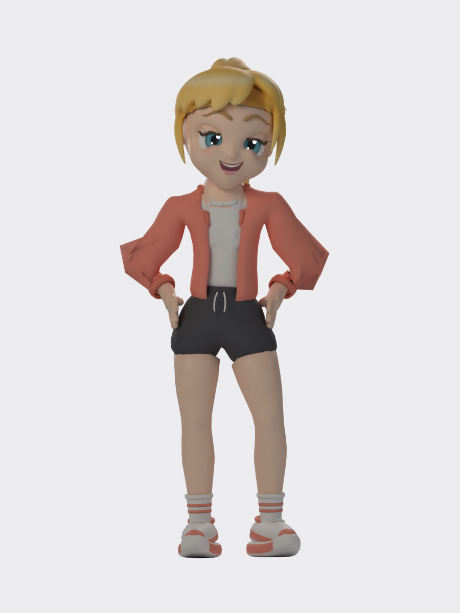

# Stylized Character (Blender)

Blender 4.2 파이썬 스크립트로만 만든 **오리지널 스타일라이즈드 카툰 캐릭터**다. 손 스컬프팅이나 AI 3D 생성, 외주 없이 헤드리스 Blender에서 모델링, 머리카락, 의상, UV/베이크, 리그, 표정, 포즈를 모두 코드로 만들었다.

- 금발 하이 포니테일 소녀, 약 5등신
- 의상 variant A: 코랄 후디, 흰 티, 차콜 반바지, 줄무늬 양말과 스니커즈
- 리그: Unity Humanoid 이름 규칙의 57본 + 포니테일 3본 + 눈 본
- 블렌드셰이프: `BigSmile`, `Blink`. 애니메이션 클립: `HandsOnHip`
- 37,519 tris, PBR 텍스처(BaseColor/Normal/Roughness)

## 프리뷰
턴어라운드 (무표정 v4)



표정과 포즈: Neutral / BigSmile / Blink, HandsOnHip



| BigSmile + HandsOnHip | BigSmile 클로즈업 | 포즈 정면 |
|---|---|---|
|  |  |  |

버전 변화 (v1 → v4): `preview/compare_versions_v1_to_v4.png`

## 파일 구조
```
source/    빌드 스크립트(*.py, *.sh)와 Blender 원본(character_master.blend, character_rigged.blend)
export/    character_game.glb(스킨+모프+애니), character_rigged.fbx, character_neutral.glb/.fbx, ponytail_bones.json
textures/  T_FaceHair_*, T_Clothes_*, T_Shoes_* (2048/1024 PBR), T_Mouth_BaseColor
preview/   렌더 프리뷰 (v1_~v3_ 접두어는 이전 버전)
HANDOFF.md 자세한 인수인계 문서: 스펙, 상태, 리그·셰이프 상세, 알려진 문제, 로드맵
```

주요 스크립트:

| 파일 | 역할 |
|---|---|
| `source/build.py` | 메인 빌드: 머리·얼굴·눈·몸·손 → 머리카락 → 의상 → (FINAL) 마무리·익스포트 |
| `source/build_hair.py` + `mc.py` | SDF 볼륨 머리카락 + marching cubes (scikit-image) |
| `source/build_outfit.py` | 후디, 티, 반바지, 양말, 신발 |
| `source/remap.py` | 5등신 비율용 다리 단축 |
| `source/finalize.py` | 숨은 면 삭제, 데시메이트, 조인, UV, 베이크, neutral 익스포트 |
| `source/rig.py` / `pose.py` | 스켈레톤, 웨이트, 셰이프키, HandsOnHip 포즈, GLB/FBX 익스포트 |
| `source/render.py` | Cycles CPU 프리뷰 렌더 |
| `source/run.sh` / `rig.sh` | 빌드·리그 래퍼 |

## 다시 빌드하기
준비물:
- **Blender 4.2.3 LTS** (헤드리스로 동작, GPU 없이 Cycles CPU)
- 머리카락 메싱용 Python venv: numpy, scikit-image
- 프리뷰 후처리용 시스템 Python + Pillow

```bash
python3 -m venv /workspace/tools/hairenv && /workspace/tools/hairenv/bin/pip install numpy scikit-image
# 스크립트는 원래 작업 경로(/workspace/character, /workspace/tools/blender-4.2.3-linux-x64/blender) 기준이다.
# 다른 위치에서 쓰면 run.sh, rig.sh, render.py, finalize.py, pose.py, build_hair.py의 경로를 고친다.
cd /workspace/character
FINAL=1 COUNT=1 SAMPLES=40 SHOTS=front,side,back,face,q34 OUTN=b001 source/run.sh   # 무표정 빌드 + 베이크 + neutral 익스포트
SAMPLES=48 RSHOTS=hero,pfront,pside,fneutral,fsmile,fblink EXPORT=1 OUTN=r001 source/rig.sh   # 리그·표정·포즈 + game GLB / rigged FBX
```
옵션과 렌더 샷 목록은 `HANDOFF.md` §5에 정리돼 있다.

## 상태와 로드맵
**완료:** 무표정 v4, 리그(57본), BigSmile, Blink, HandsOnHip, three.js 헤드리스 로드 확인.

**알려진 문제:**
- 90° 굽힘에서 팔꿈치 소매가 각지게 접힌다.
- 입 안쪽이 텍스처 평면이고 턱 본이 없다.
- 37.5k tris로 목표(≤35k)를 넘는다.
- Unity Humanoid 임포트는 아직 테스트하지 않았다.

**로드맵:**
1. 나머지 표정 13개 (총 15개)
2. 실제 치아·혀 지오메트리
3. 팔꿈치 보정
4. ≤35k로 최적화
5. Unity 검증
6. 웨이트 극단 포즈 테스트

자세한 내용은 [HANDOFF.md](HANDOFF.md) 참고.

## 라이선스
- **스크립트·코드** (`source/*.py`, `source/*.sh`): [MIT](LICENSE) © 2026 jeonghwanko
- **모델·텍스처·프리뷰·문서** (`*.blend`, `export/*`, `textures/*`, `preview/*`): [CC BY 4.0](LICENSE-ASSETS) © 2026 jeonghwanko. 출처 표기: "Stylized Character (Blender) by jeonghwanko, CC BY 4.0"

캐릭터 디자인은 오리지널이다. 영감을 준 레퍼런스 이미지는 저작권 문제로 저장소에 포함하지 않았다.
