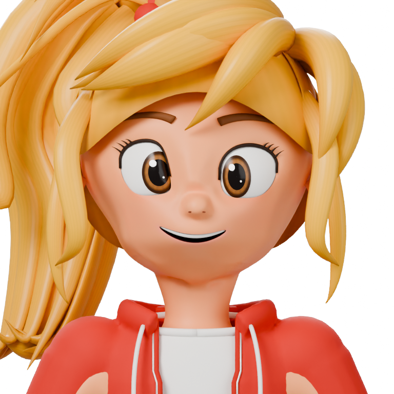
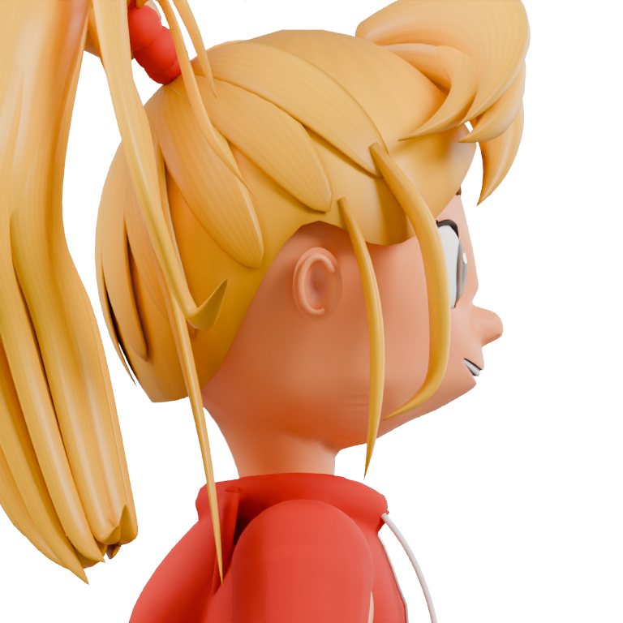
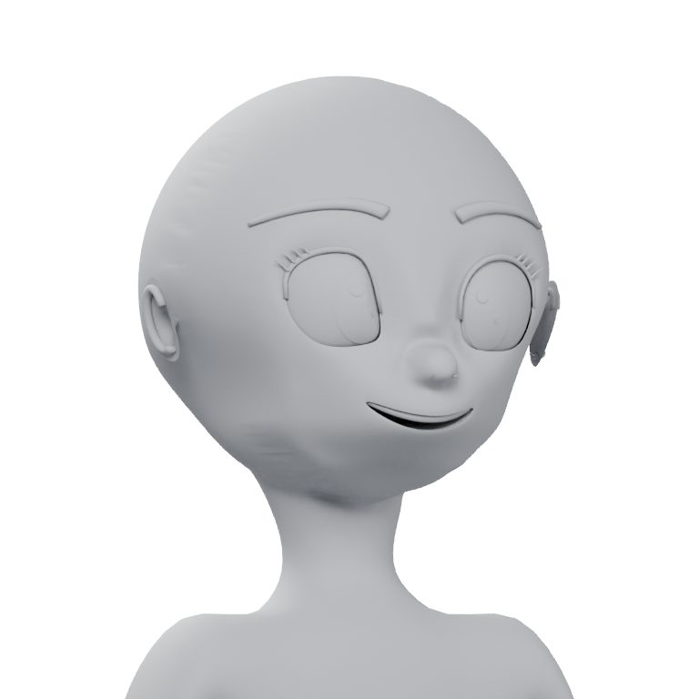

# 얼굴 표면 연구 체크포인트 — 미완성

이 폴더는 기존 v4 배포 모델과 별도의 실험 기록이다. **n05는 닮음 검토를 통과하지 않았다. 제작용 Neutral/BigSmile 리그도 아니다.** 기존 `source/character_master.blend`, `source/character_rigged.blend` 및 `export/`는 변경하지 않았다.

## 포함한 모델

| 파일 | 용도 | 제한 |
|---|---|---|
| `checkpoints/face_study_77.blend` | 연속된 머리·목·상체 피부를 가진 큰 미소 연구 기준점. n05 재현의 입력 | 큰 미소가 피부 좌표에 구워져 있다. 새 피부의 표정키 없음 |
| `checkpoints/neutral_n05.blend` | 입술·볼 연결·치아·구강을 함께 조정한 작은 미소 연구 | 아래 얼굴이 길고 무겁고, 입술이 얇으며 코·볼 연결과 턱 옆 굴곡이 부족함 |

두 모델의 사용 이미지9개는 blend 내부에 포함되어 있다. 외부 linked Blender library는 없다. 공개 사본에서는 로컬 절대 경로, 임베디드 텍스트와 텍스처의 EXIF 등 부가 메타데이터를 제거하고 메시 좌표·면·가중치가 변하지 않았는지 재확인했다. 픽셀·알파·색상 인코딩 데이터는 유지한다. 원본 모델의 기존 기능과 연구 피부의 상태를 혼동하지 않아야 한다.

## 모델만 포함한 미리보기

| 정면 | 실제90도 측면 | 회색 표면 검토 |
|---|---|---|
|  |  |  |

직립 포즈, 정사영 배율0.55,768×768, 동일한 조명으로 렌더했다. 정면의 작은 미소는 관찰된 정면 중립 표정의 복제가 아니라 설계 추정이다. 참조 원본, 참조가 섞인 비교 그림 및 개인 작업 자료는 포함하지 않는다.

## 재현

검증 환경은 **Blender4.5.10LTS**, 시스템 Python3.10, NumPy2.2.6, SciPy1.15.3이다. 기존 v4의 Blender4.2.3 환경과 별개다. 이 스크립트는 패키지를 설치하거나 네트워크에 접근하지 않는다.

저장소 루트에서 실행한다. Blender가 PATH에 없으면 `--blender`에 실행 파일 경로를 지정한다.

```bash
python source/research/scripts/reproduce.py --blender blender --render
```

결과는 Git에서 제외한 `work/facial-research/`에 생성된다. `--work-dir`로 별도 폴더를 지정할 수 있다. 공개 체크포인트 폴더를 출력 대상으로 지정할 수 없다.

파이프라인은77의 버전 고정 상태 → 새 작은 미소 n02 → 넓은3차원 표면 정리 n03 → 턱/코 비율과 새 치아 n04 → 입술·구강의 동반 이동 n05 순서다. `parameters/`에는 재현에 필요한 고정 제어값과77의 면 선택을 보관했다. 과거 모든 시행착오를 다시 실행하거나 원래 디자인을 이미지에서 자동 복원하는 파이프라인은 아니다.

위 검증 환경에서 이 경로를 실제 실행해 공개 n05와 비교했다.62개 메시의 최대 정점 거리와 뼈 기준 행렬 차이는 모두0이었다. `compare_reproduction.py`가 이 검사를 수행한다. 이는 형상 재현 확인이며 닮음이나 표정 품질의 승인과는 별개다.

현재 공개 n05만 검사하려면:

```bash
blender --background --factory-startup --disable-autoexec --python-exit-code 1 --python source/research/scripts/validate_checkpoint.py
```

스크립트는 `use_scripts=False`로 파일을 연다. 별도의 `sanitize_checkpoint.py`는 공개 사본을 만들 때만 사용하는 도구이며 기존 파일을 덮어쓰지 않는다.

## 검증 범위

n05 피부는6010정점/9757면, 연결 성분1개다. 세 면 이상이 공유하는 모서리0개, 면적0면0개, 가중치 없는 정점0개다. 눈192점과 입96점의 열린 경계288개가 의도적으로 남아 있으므로 닫힌 메시라고 부르지 않는다.

77 대비 목 가중치가 있는869점과 눈 경계192점의 위치 차이0,57개 뼈의 기준 행렬 차이0을 확인했다. 이 수치는 **닮음, 전체 포즈, UV, 표정키, 게임 엔진 수출 품질을 보증하지 않는다.** 해당 항목은 미완료다. 새로운 GLB/FBX는 만들지 않았다.

실패 원인과 작업 재개 지점은 [NEXT_STEPS.md](NEXT_STEPS.md)에 정리했다.

## 라이선스와 출처

스크립트는 저장소의 [MIT](../../LICENSE) 라이선스, 모델과 미리보기는 기존 [CC BY4.0](../../LICENSE-ASSETS) 라이선스를 따른다. 라이선스를 변경하지 않았다.

출처: **Stylized Character (Blender) by jeonghwanko, CC BY4.0** — <https://github.com/jeonghwanko/stylized-character-blender>
